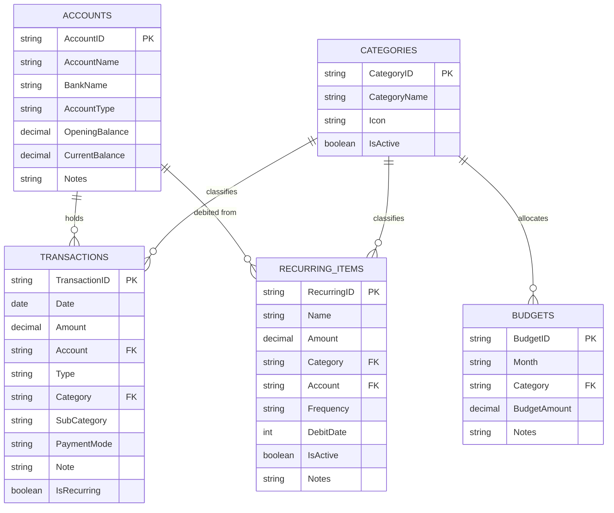

# Expense Management AppSheet Templates

This directory contains production-ready CSV template files designed for building a personal or household Expense Management application using **Google Sheets** and **Google AppSheet**.

---

## 📁 File Manifest

| File | Purpose | Primary Key | Suggested Label |
|---|---|---|---|
| [`accounts.csv`](./accounts.csv) | Tracks bank accounts, wallets, and cash balances | `AccountID` | `AccountName` |
| [`transactions.csv`](./transactions.csv) | Records daily income, expense, and transfer events | `TransactionID` | `TransactionID` / `Note` |
| [`recurring_items.csv`](./recurring_items.csv) | Manages automated subscriptions, SIPs, and bills | `RecurringID` | `Name` |
| [`budgets.csv`](./budgets.csv) | Sets monthly spending limits per category | `BudgetID` | `Category` |
| [`categories.csv`](./categories.csv) | Master taxonomy of spending and income categories | `CategoryID` | `CategoryName` |

---

## 🏗️ Entity Relationship Diagram (ERD)

---

## 📋 Data Dictionary & AppSheet Configuration

### 1. `accounts.csv`
Tracks financial accounts and current balances.

| Column | Recommended AppSheet Type | Key? | Label? | Notes / Expressions |
|---|---|:---:|:---:|---|
| `AccountID` | `Text` | ✅ | | Initial value: `UNIQUEID()` |
| `AccountName` | `Text` | | ✅ | e.g. "Account 1", "Account 2", "Cash Wallet" |
| `BankName` | `Text` | | | e.g. "State Bank of India", "HDFC Bank", "Cash" |
| `AccountType` | `Enum` | | | Allowed values: `Savings`, `Current`, `Salary`, `Credit Card`, `Cash`, `Wallet` |
| `OpeningBalance` | `Price` (INR) | | | Initial opening balance |
| `CurrentBalance` | `Price` (INR) | | | Virtual Column or computed field: `[OpeningBalance] + SUM(SELECT(Transactions[Amount], AND([Account] = [_THISROW].[AccountName], [Type] = "Income"))) - SUM(SELECT(Transactions[Amount], AND([Account] = [_THISROW].[AccountName], [Type] = "Expense")))` |
| `Notes` | `LongText` | | | Free-form account description |

---

### 2. `transactions.csv`
Records every financial transaction.

| Column | Recommended AppSheet Type | Key? | Label? | Notes / Expressions |
|---|---|:---:|:---:|---|
| `TransactionID` | `Text` | ✅ | | Initial value: `UNIQUEID()` |
| `Date` | `Date` | | | Format: `YYYY-MM-DD`. Default: `TODAY()` |
| `Amount` | `Price` (INR) | | | Numeric transaction amount |
| `Account` | `Ref` | | | References `accounts(AccountName)` |
| `Type` | `Enum` | | | Allowed values: `Income`, `Expense`, `Transfer` |
| `Category` | `Ref` | | | References `categories(CategoryName)` |
| `SubCategory` | `Text` | | | Optional subcategory detail |
| `PaymentMode` | `Enum` | | | Allowed values: `UPI`, `Card`, `Cash`, `NetBanking`, `AutoDebit` |
| `Note` | `LongText` | | ✅ | Description of the transaction |
| `IsRecurring` | `Yes/No` | | | `Y` if generated or part of recurring item |

---

### 3. `recurring_items.csv`
Defines recurring payments and debits.

| Column | Recommended AppSheet Type | Key? | Label? | Notes / Expressions |
|---|---|:---:|:---:|---|
| `RecurringID` | `Text` | ✅ | | Initial value: `UNIQUEID()` |
| `Name` | `Text` | | ✅ | e.g. "HDFC Top 100 Index Fund SIP" |
| `Amount` | `Price` (INR) | | | Expected debit amount |
| `Category` | `Ref` | | | References `categories(CategoryName)` |
| `Account` | `Ref` | | | References `accounts(AccountName)` |
| `Frequency` | `Enum` | | | Allowed values: `Monthly`, `Quarterly`, `Yearly` |
| `DebitDate` | `Number` | | | Day of month (1 to 31) |
| `IsActive` | `Yes/No` | | | `Y` or `N` flag |
| `Notes` | `LongText` | | | Automation notes or subscription plan details |

---

### 4. `budgets.csv`
Defines monthly spending caps by category.

| Column | Recommended AppSheet Type | Key? | Label? | Notes / Expressions |
|---|---|:---:|:---:|---|
| `BudgetID` | `Text` | ✅ | | Initial value: `UNIQUEID()` |
| `Month` | `Text` | | | Format: `YYYY-MM` (e.g. `2026-11`) |
| `Category` | `Ref` | | ✅ | References `categories(CategoryName)` |
| `BudgetAmount` | `Price` (INR) | | | Allocated spending budget |
| `Notes` | `LongText` | | | Purpose or notes on the budget allocation |

---

### 5. `categories.csv`
Categorization master list for all transactions, recurring items, and budgets.

| Column | Recommended AppSheet Type | Key? | Label? | Notes / Expressions |
|---|---|:---:|:---:|---|
| `CategoryID` | `Text` | ✅ | | Initial value: `UNIQUEID()` |
| `CategoryName` | `Text` | | ✅ | Unique category name |
| `Icon` | `Text` / `Thumbnail` | | | Material design icon name or image |
| `IsActive` | `Yes/No` | | | `Y` or `N` flag |

---

## 🚀 How to Import into Google Sheets & AppSheet

1. **Upload to Google Drive / Sheets**:
   - Create a new Google Spreadsheet (e.g., `Expense_Tracker_DB`).
   - Import each CSV into its own sheet tab named: `accounts`, `transactions`, `recurring_items`, `budgets`, and `categories`.
2. **Connect to AppSheet**:
   - In Google Sheets, navigate to **Extensions > AppSheet > Create an App**, or visit [AppSheet](https://www.appsheet.com) and create an app from Google Drive.
   - Add all 5 sheets as tables.
3. **Configure Column Types**:
   - AppSheet will automatically detect keys and types based on headers and sample rows.
   - Adjust References (`Ref`) and Enums as specified in the Data Dictionary tables above.
